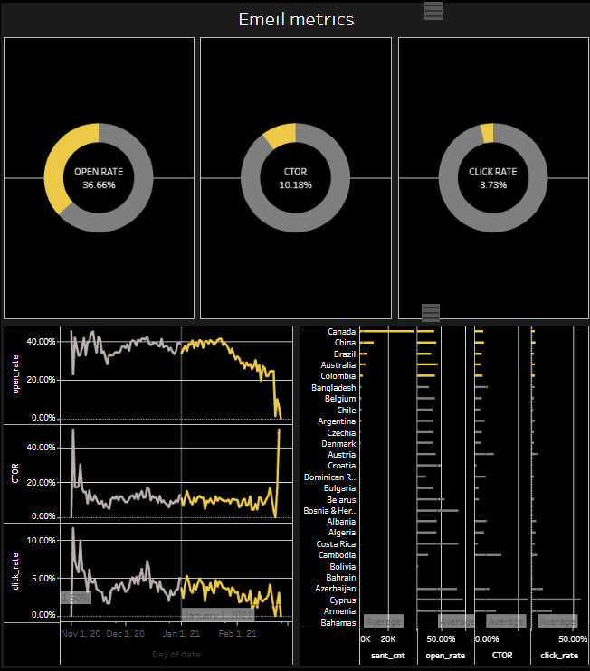

# Tableau Portfolio

**Maksym Voronenko | Data Analyst**

A selection of my interactive dashboards built with Tableau.

**Tools:** Tableau, Tableau Public.

## 1. Email Metrics Dashboard

[Open interactive dashboard](https://public.tableau.com/views/Emeilmetrics_17831494101960/Emeilmetrics)

---

## 2. Revenue Analysis Dashboard

A sales dashboard for exploring revenue and order volume over time, by product category and device.

### Dashboard Features

- Revenue and order count KPIs with daily trends.
- Comparison of revenue and orders across product categories.
- Revenue and order breakdowns by device.
- Top 10 products by revenue.
- Filters for date, country, and product category.

[Open interactive dashboard](https://public.tableau.com/app/profile/maxim.voronenko2142/viz/AnalysisRevenue_17829294647690/Sales)

---

## More Dashboards

[View my Tableau Public portfolio](https://public.tableau.com/app/profile/maxim.voronenko2142/vizzes)
